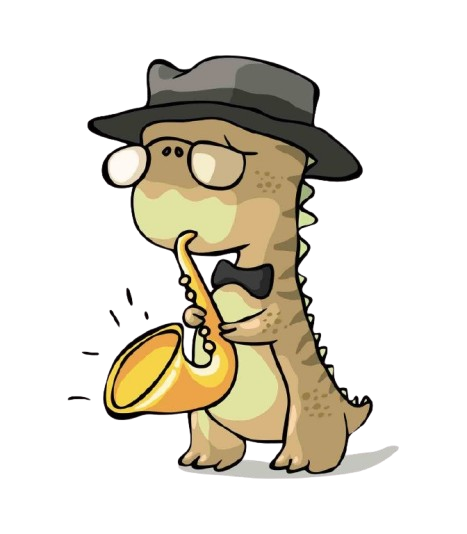

    

<h1 align="center" font="JetBrains">Hewwow~ Imma a eepy dinosaur - Bella!!!</h1>

<h3 align="center">Business & Operations | Creative & Digital</h3>

  

<h2 align="center">🦖 About Me</h2>

So here's a little about me! I'm a Management graduate with a curious mind, an eye for details, and a soft spot for creativity.
I enjoy exploring new ideas, oranizing things, understanding people, and solving problems in innovative ways. My goal is to make things happen and bring ideas to life.
 
 
I wear different hats along the way — from handling administrative tasks and coordinating operations to bringing creative ideas to life. I believe in the power of collaboration and continuous learning, and I'm always eager to take on new challenges that allow me to grow both personally and professionally.
 
 
My usual routine? Explore an idea ➞ make a plan ➞ figure things out ➞ get things done ➞ learn something new ➞ repeat.
 
 
Always curious, occasinaonally overthinking the details, and constantly finding new ways to grow. Because there's always something new to learn and something meaningful to create.
 

<h2 align="center">🤝 Connect</h2>

<h2 align="center">📊 GitHub Stats</h2>

